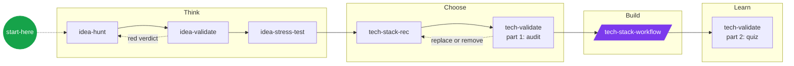

<a href="#the-flow">
  
</a>

<h1 align="center">MathAlgo Skills</h1>

<p align="center"><b>English</b> · <a href="README.vi.md">Tiếng Việt</a></p>

<p align="center">
  <b>Agent skills that think like a skeptical senior engineer.</b><br>
  Problem first. Boring tech first. Drawbacks always.
</p>

<p align="center">
  
  
  
</p>

<p align="center">
  <a href="#the-flow">The flow</a> ·
  <a href="#skills">Skills</a> ·
  <a href="#quick-start">Quick start</a> ·
  <a href="#how-it-remembers">How it remembers</a> ·
  <a href="#adding-a-skill">Adding a skill</a>
</p>

---

## Why

AI agents are fast and agreeable. That is the problem. They praise weak ideas, pile on trendy tech, and call things "done" before anyone understands them.

These skills push the other way:

| Principle | In practice |
|---|---|
| **Problem before solution** | No "AI app for X". Find real pain with evidence first. |
| **Try to KILL it** | Ideas and tech choices must survive an honest attack before they get built. |
| **Boring tech first** | A proven core stack by default. Anything exotic needs a reason tied to the project. |
| **Drawbacks always** | Every recommendation ships with how it fails. |
| **Understand what you ship** | Projects end with a quiz on your own code, not a green checkmark. |

## The flow



<sub>🟣 Parallelogram = user-invoked (type the slash command). 🟢 Circle = router. Everything else loads automatically when the task fits.</sub>

Not sure where you are? Run `/start-here`. It reads the project's `docs/` and names the next step.

## Skills

### Productivity
Non-code work: ideas, research, planning.

**Model-invoked**

| Skill | What it does | Writes to |
|---|---|---|
| [start-here](skills/productivity/start-here/SKILL.md) | Routes you to the right skill or flow | |
| [idea-hunt](skills/productivity/idea-hunt/SKILL.md) | Finds a real, painful, niche problem worth solving | |
| [idea-validate](skills/productivity/idea-validate/SKILL.md) | Checks demand, competitors and who already failed | `docs/idea.md` |
| [idea-stress-test](skills/productivity/idea-stress-test/SKILL.md) | Finds where a validated idea breaks: scale, money, distribution, risk | `docs/idea.md` |

### Engineering
Building software: choose a stack, build it, prove you understand it.

**User-invoked**

| Skill | What it does | Writes to |
|---|---|---|
| [tech-stack-workflow](skills/engineering/tech-stack-workflow/SKILL.md) | Builds the project phase by phase, each phase working, tested and committed | `docs/progress.md` |

**Model-invoked**

| Skill | What it does | Writes to |
|---|---|---|
| [front-end-design](skills/engineering/front-end-design/SKILL.md) | Designs distinctive UI that does not look AI-generated | `docs/design.md` |
| [tech-stack-rec](skills/engineering/tech-stack-rec/SKILL.md) | Recommends a proven core stack, niche tech only when justified | `docs/stack.md` |
| [tech-validate](skills/engineering/tech-validate/SKILL.md) | Audits the stack before building, quizzes you after finishing | |

<details>
<summary><b>The default core stack</b></summary>
<br>

| Layer | Choice |
|---|---|
| API | FastAPI + Pydantic |
| Database | PostgreSQL + SQLAlchemy + Alembic |
| Tests | pytest |
| Container | Docker + docker-compose |
| CI/CD | GitHub Actions |
| Deploy | Vercel (flagged when the backend needs long-running work) |
| ML | pandas, RandomForest or XGBoost (justified per dataset), matplotlib |

</details>

## Quick start

Windows + Git Bash. Your Claude config lives wherever you want, not on `C:`.

```bash
# 1. Clone
git clone https://github.com/<you>/skills.git D:/Programming/skills

# 2. Point Claude Code at a config folder (run in cmd, then reopen all terminals)
setx CLAUDE_CONFIG_DIR D:\Programming\.claude-config

# 3. Link skills + global instructions
cd /d/Programming/skills && bash scripts/link-skills.sh
```

Open `claude`, type `/skills`, and all of them should be listed.

<details>
<summary><b>What the link script does</b></summary>
<br>

- Creates one Windows junction per skill in `$CLAUDE_CONFIG_DIR/skills/`, pointing back into this repo. Edit here, the agent sees it instantly.
- Skips `misc/` and `deprecated/`.
- Copies `global/CLAUDE.md` into the config folder. Edit the repo copy only, the other one gets overwritten.
- Leaves real folders such as `synced/` (app-managed account skills) alone.

</details>

## How it remembers

The agent forgets everything between sessions. Projects don't.

```
my-project/
└── docs/
    ├── idea.md       ← idea-validate, idea-stress-test
    ├── stack.md      ← tech-stack-rec
    └── progress.md   ← tech-stack-workflow, updated every phase
```

New session: *"read docs/progress.md and continue"*. No re-explaining.

## Repo layout

```
skills/
├── CLAUDE.md              rules for maintaining this repo
├── global/CLAUDE.md       how the agent works with me, in every project
├── scripts/link-skills.sh
└── skills/
    ├── productivity/      promoted
    ├── engineering/       promoted
    ├── in-progress/       drafts, linked but not listed above
    ├── misc/              rarely used, not linked
    └── deprecated/        retired, not linked
```

## Adding a skill

The rule of three: explained the same thing to an agent three times? It becomes a skill.

- [ ] `skills/<bucket>/<name>/SKILL.md`, English, Goal / Steps / Rules / Output, under 50 lines
- [ ] At least one rule about drawbacks or failure modes
- [ ] Listed in the bucket `README.md` and, if promoted, here (and bump the skill count badge)
- [ ] `start-here` updated if it changes a flow
- [ ] Vietnamese twin `SKILL.vi.md` (and `README.vi.md` entries) in sync
- [ ] `bash scripts/link-skills.sh`

Full rules live in [CLAUDE.md](CLAUDE.md).

---

<p align="center">
  <sub>Structure inspired by <a href="https://github.com/mattpocock/skills">mattpocock/skills</a>. Built for how MathAlgo works.</sub>
</p>
