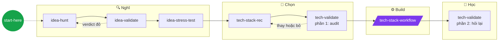

<a href="#flow">
  
</a>

<h1 align="center">MathAlgo Skills</h1>

<p align="center"><a href="README.md">English</a> · <b>Tiếng Việt</b></p>

<p align="center">
  <b>Bộ skill giúp agent suy nghĩ như một senior engineer đa nghi.</b><br>
  Vấn đề trước. Công nghệ nhàm chán trước. Luôn nói drawback.
</p>

<p align="center">
  
  
  
</p>

<p align="center">
  <a href="#flow">Flow</a> ·
  <a href="#skills">Skills</a> ·
  <a href="#bắt-đầu-nhanh">Bắt đầu nhanh</a> ·
  <a href="#cách-nó-ghi-nhớ">Cách nó ghi nhớ</a> ·
  <a href="#thêm-skill-mới">Thêm skill mới</a>
</p>

---

## Vì sao

AI agent vừa nhanh vừa dễ dãi. Đó chính là vấn đề: nó khen idea yếu, nhồi công nghệ đang hot, và báo "xong rồi" trước khi ai kịp hiểu gì.

Bộ skill này kéo theo hướng ngược lại:

| Nguyên tắc | Trong thực tế |
|---|---|
| 🔍 **Vấn đề trước giải pháp** | Không có kiểu "app AI cho X". Tìm nỗi đau thật, có bằng chứng, trước đã. |
| 🪓 **Cố giết nó** | Idea và lựa chọn công nghệ phải sống sót qua một đợt tấn công thẳng thắn rồi mới được build. |
| 🧱 **Công nghệ nhàm chán trước** | Mặc định dùng core stack đã kiểm chứng. Thứ gì lạ phải có lý do gắn với project. |
| ⚠️ **Luôn nói drawback** | Mọi đề xuất đều kèm theo việc nó hỏng thế nào. |
| 🧠 **Hiểu cái mình ship** | Project kết thúc bằng bài hỏi về chính code của mình, không phải một dấu tick xanh. |

## Flow



<sub>🟣 Hình bình hành = user-invoked (phải gõ lệnh slash). 🟢 Hình tròn = router. Còn lại tự load khi việc phù hợp.</sub>

Không biết mình đang ở đâu? Chạy `/start-here`. Nó đọc `docs/` của project và chỉ ra bước tiếp theo.

## Skills

### 💡 Productivity
Việc không phải code: idea, research, lên kế hoạch.

**Model-invoked**

| Skill | Làm gì | Ghi vào |
|---|---|---|
| [start-here](skills/productivity/start-here/SKILL.vi.md) | Chỉ tới đúng skill hoặc flow | |
| [idea-hunt](skills/productivity/idea-hunt/SKILL.vi.md) | Tìm một vấn đề thật, đau thật, đủ niche để giải quyết | |
| [idea-validate](skills/productivity/idea-validate/SKILL.vi.md) | Kiểm tra nhu cầu, đối thủ và những ai đã thất bại | `docs/idea.md` |
| [idea-stress-test](skills/productivity/idea-stress-test/SKILL.vi.md) | Tìm chỗ idea đã validate sẽ gãy: scale, tiền, phân phối, rủi ro | `docs/idea.md` |

### 🛠️ Engineering
Build phần mềm: chọn stack, build, chứng minh mình hiểu nó.

**User-invoked**

| Skill | Làm gì | Ghi vào |
|---|---|---|
| [tech-stack-workflow](skills/engineering/tech-stack-workflow/SKILL.vi.md) | Build project theo từng phase, phase nào cũng chạy được, đã test, đã commit | `docs/progress.md` |

**Model-invoked**

| Skill | Làm gì | Ghi vào |
|---|---|---|
| [tech-stack-rec](skills/engineering/tech-stack-rec/SKILL.vi.md) | Gợi ý core stack đã kiểm chứng, công nghệ niche chỉ khi có lý do | `docs/stack.md` |
| [tech-validate](skills/engineering/tech-validate/SKILL.vi.md) | Audit stack trước khi build, hỏi lại m sau khi xong | |

<details>
<summary><b>Core stack mặc định</b></summary>
<br>

| Layer | Lựa chọn |
|---|---|
| API | FastAPI + Pydantic |
| Database | PostgreSQL + SQLAlchemy + Alembic |
| Test | pytest |
| Container | Docker + docker-compose |
| CI/CD | GitHub Actions |
| Deploy | Vercel (có cảnh báo khi backend cần chạy tác vụ dài) |
| ML | pandas, RandomForest hoặc XGBoost (chọn theo từng dataset, có giải thích), matplotlib |

</details>

## Bắt đầu nhanh

Windows + Git Bash. Config của Claude nằm ở đâu m muốn, không phải ổ `C:`.

```bash
# 1. Clone
git clone https://github.com/<you>/skills.git D:/Programming/skills

# 2. Trỏ Claude Code tới folder config (chạy trong cmd, rồi mở lại mọi terminal)
setx CLAUDE_CONFIG_DIR D:\Programming\.claude-config

# 3. Link skill + chỉ dẫn global
cd /d/Programming/skills && bash scripts/link-skills.sh
```

Mở `claude`, gõ `/skills`, phải thấy đủ hết.

<details>
<summary><b>Script link làm gì</b></summary>
<br>

- Tạo một Windows junction cho mỗi skill trong `$CLAUDE_CONFIG_DIR/skills/`, trỏ ngược về repo này. Sửa ở đây là agent thấy ngay.
- Bỏ qua `misc/` và `deprecated/`.
- Copy `global/CLAUDE.md` vào folder config. Chỉ sửa bản trong repo, bản kia sẽ bị ghi đè.
- Không đụng tới các folder thật như `synced/` (skill của tài khoản, do app quản lý).

</details>

## Cách nó ghi nhớ

Agent quên sạch giữa các session. Project thì không.

```
my-project/
└── docs/
    ├── idea.md       ← idea-validate, idea-stress-test
    ├── stack.md      ← tech-stack-rec
    └── progress.md   ← tech-stack-workflow, cập nhật sau mỗi phase
```

Session mới: *"đọc docs/progress.md rồi làm tiếp"*. Khỏi giải thích lại.

## Cấu trúc repo

```
skills/
├── CLAUDE.md              luật để maintain repo này
├── global/CLAUDE.md       cách agent làm việc với t, ở mọi project
├── scripts/link-skills.sh
└── skills/
    ├── productivity/      promoted
    ├── engineering/       promoted
    ├── in-progress/       nháp, có link nhưng không liệt kê ở trên
    ├── misc/              ít dùng, không link
    └── deprecated/        đã bỏ, không link
```

Mỗi file `.md` đều có bản tiếng Việt `.vi.md` nằm cạnh. Bản tiếng Anh là bản gốc, agent chỉ đọc bản đó.

## Thêm skill mới

Luật số ba: giải thích cùng một thứ cho agent tới lần thứ ba? Biến nó thành skill.

- [ ] `skills/<bucket>/<name>/SKILL.md`, tiếng Anh, Goal / Steps / Rules / Output, dưới 50 dòng
- [ ] Ít nhất một luật về drawback hoặc kiểu hỏng
- [ ] Có trong `README.md` của bucket và, nếu là promoted, ở README chính (nhớ tăng số trên badge)
- [ ] Cập nhật `start-here` nếu nó làm đổi flow
- [ ] Bản tiếng Việt `SKILL.vi.md` (và các mục trong `README.vi.md`) khớp với bản gốc
- [ ] `bash scripts/link-skills.sh`

Đầy đủ luật nằm trong [CLAUDE.vi.md](CLAUDE.vi.md).

---

<p align="center">
  <sub>Cấu trúc lấy cảm hứng từ <a href="https://github.com/mattpocock/skills">mattpocock/skills</a>. Làm riêng cho cách MathAlgo làm việc.</sub>
</p>
